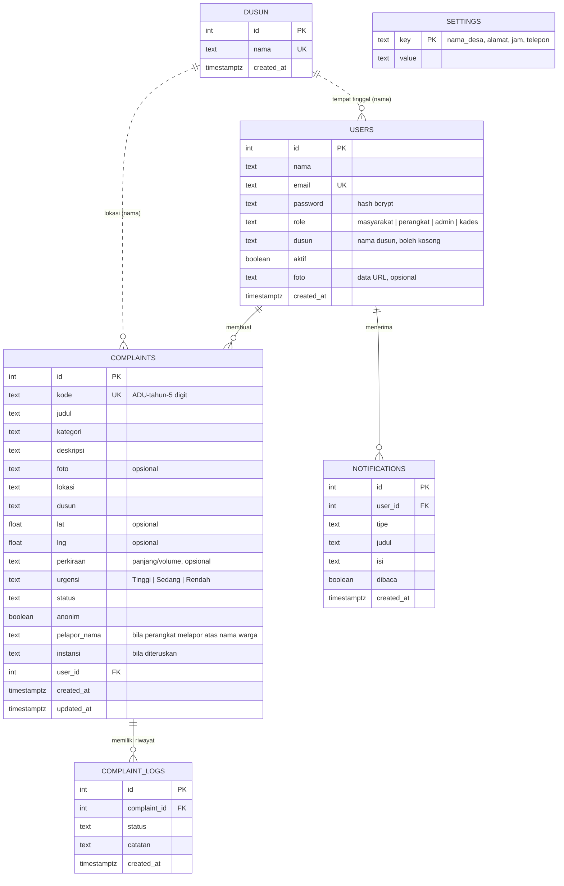

# ERD (Entity Relationship Diagram)

Sumber: `backend/schema.sql`. Diagram memakai sintaks Mermaid, tampil otomatis di GitHub. Untuk laporan, salin kode di bawah ke [mermaid.live](https://mermaid.live) lalu ekspor sebagai PNG atau SVG.

## Catatan rancangan

- **Dusun dan pengguna/pengaduan** dihubungkan lewat nama (teks), bukan kunci asing. Ini sengaja disederhanakan; API memastikan nama dusun yang dipilih ada di tabel `dusun`, dan dusun yang sudah dipakai tidak dapat dihapus (HTTP 409). Jika ingin lebih ketat, ubah menjadi `dusun_id` dengan kunci asing.
- **settings** adalah tabel kunci-nilai tanpa relasi (nama desa, alamat, jam layanan, telepon).
- **complaint_logs** mencatat setiap perubahan status dan setiap tanggapan. Halaman pelacakan publik menampilkan tabel ini tanpa data pribadi.
- Status yang diizinkan: Diterima, Diverifikasi, Masuk Perencanaan, Dalam Perbaikan, Selesai, Diteruskan ke Instansi, Ditolak. Perpindahan antarstatus dibatasi (tabel `TRANSISI` di `backend/src/config.js`).
- Kode pengaduan dibuat dari sequence `complaint_seq`, jadi tidak ada dua pengaduan dengan kode yang sama walau dikirim bersamaan.
